# Rill

**Redis 不该让人等。** 一款为 macOS 打造的轻量、键盘优先的 Redis 客户端。

Rill 用 Tauri 2 + Rust 构建：安装包约 **13 MB**，常驻内存约 **100 MB**，冷启动通常 1 秒左右。它不会用 `KEYS *` 拖垮你的生产实例，也不会在十万个 Key 面前卡成幻灯片。

<p align="center">
  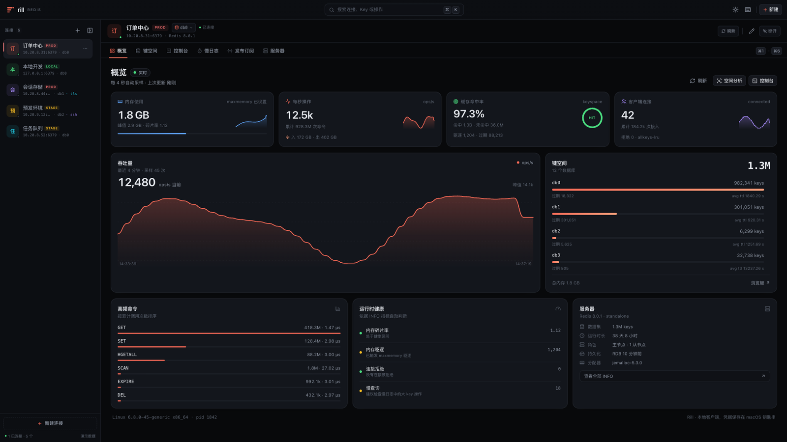
</p>

<p align="center">
  <sub>深色主题 · 实时指标 · SCAN 增量键空间 · 类型化编辑器 · 命令面板</sub>
</p>

---

## 为什么又做一个 Redis 客户端

现有工具不是不能用了，而是在真实工作流里总有几个地方让人皱眉：

| 痛点 | 常见表现 | Rill 的做法 |
| --- | --- | --- |
| 太重、太慢 | Electron 客户端冷启动数秒、内存几百 MB | Tauri + 系统 WKWebView，Rust 后端；13 MB 应用、百 MB 级内存 |
| 打开大库就卡 | 启动即 `KEYS *`，或一次性渲染全部 Key | 只用 `SCAN` 游标，虚拟列表 + 按需加载；稀疏匹配自动多扫几轮 |
| 找 Key 靠肉眼 | 平铺列表、不能按命名空间浏览 | 命名空间树、glob 搜索、⌘K 直接搜 Key |
| 只能看不能改 | Hash/List/ZSet 只读，TTL 看不见 | 六种类型的查看与编辑、行内编辑、TTL 修改、重命名、删除 |
| 生产环境不敢点 | 没有只读保护、危险命令无确认、密码明文 | 只读保护（前后端双重拦截）、危险命令二次确认、密码进 macOS 钥匙串 |
| 连接方式不全 | SSH/TLS/ACL/多 DB 支持零散 | TLS（rustls）、SSH 本地转发、ACL 用户名、DB 选择、SSH key |
| 键盘不友好 | 所有操作都要点鼠标 | ⌘K 命令面板、⌘1–6 切页、↑↓ 选 Key、⌘S 保存、历史命令 |
| 不好看 | 信息密度低、配色刺眼、只有浅色 | 深色优先的双主题、克制的珊瑚色强调、等宽数据字体 |

更完整的竞品拆解与产品判断见 [docs/ANALYSIS.md](docs/ANALYSIS.md)。

---

## 功能

### 连接管理

- 单机 Redis，支持 DB 0–15、ACL 用户名、TLS（含跳过证书校验）、SSH 跳板机
- 环境标记（生产 / 预发 / 开发 / 本地）与颜色标识
- 连接测试、延迟显示，断开 / 重连
- 密码写入 **macOS 钥匙串**，配置文件只保留元数据（权限 600）
- 只读保护：UI 禁用写入，Rust 后端再次校验，控制台仅允许读命令

### 键空间

- `SCAN` 游标增量加载，永不使用 `KEYS *`
- 列表 / 命名空间树双视图，类型过滤
- 命名空间树由后端全量 `SCAN` 聚合完整前缀计数，不受列表 200 条分页限制；展开层级时懒加载该层 Key，选中 Key 不切换视图
- 每个命名空间记录直属 Key 数；展开时后端只返回这一层的直属 Key（一次最多 200 个），不会把子空间 Key 混进来
- 「加载更多」按钮显示已加载/直属总数，达到数量立即结束；稀疏直属 Key 也会一次批量返回，不会一次只出 1–2 个
- 数据库自由切换：`SELECT` 实时切换，展示每个 DB 的 Key 数量，不需要编辑连接
- 大小写不敏感的子串 / 子序列模糊筛选，支持 `*` `?` 通配；边输入边过滤
- 虚拟滚动，面向十万级 Key 的键空间
- 类型感知图标、TTL 预警、内存占用
- 新建 / 重命名 / 删除 / 设置 TTL / 移除 TTL
- 命名空间一键筛选（`user:*`）

### 类型化编辑器

| 类型 | 查看 | 编辑 |
| --- | --- | --- |
| String | JSON 高亮、格式化、换行、复制、512 KB 截断保护 | 全量编辑、⌘S 保存、保留 TTL |
| Hash | 分页表格 | 行内编辑 Value、新增 / 删除 Field |
| List | 分页表格（索引） | 行内编辑、头/尾插入、按值删除 |
| Set | 成员列表 | 新增 / 移除成员 |
| Sorted Set | Member / Score 表格 | 修改 Score、新增 / 移除成员 |
| Stream | Entry + Fields 只读展示 | 使用控制台 `XADD` |

二进制或已截断的 String 会自动锁定编辑，避免误覆盖数据。

### 控制台

- 完整 RESP2 返回类型渲染（状态、整数、批量、数组、Map、Double、Bool）
- `INFO` 着色、`HGETALL` / `CONFIG GET` / `ZRANGE WITHSCORES` 自动成对展示
- 命令历史（本地保存）、↑↓ 翻阅
- 复制走原生 `pbcopy`，不受 WebView 剪贴板沙箱限制
- `FLUSHALL` / `FLUSHDB` / `CONFIG SET` / `CLIENT KILL` 二次确认；`KEYS` 直接禁用，引导使用 SCAN
- 阻塞连接的命令（`MONITOR`、`BLPOP`、`SUBSCRIBE`…）会被拒绝并给出替代方案

### 服务端洞察

- 概览：内存 / 吞吐 / 命中率 / 客户端 / 键空间 / 高频命令 / 运行时健康
- 4 秒采样、客户端 SVG 折线图与环形图
- `INFO` 全量分区浏览与搜索、`CLIENT LIST` 表
- 慢日志：耗时条、命令展开、按耗时排序、清空
- 空间分析：抽样 `MEMORY USAGE`，定位最大的 Key 与命名空间热点

### 发布订阅

- 频道发现（`PUBSUB CHANNELS`）、通配符订阅（`PSUBSCRIBE`）
- 独立连接接收消息，不阻塞键空间操作
- 实时消息流、JSON 高亮、筛选、暂停滚动、发布消息

### 体验

- ⌘K 命令面板：跳转页面、切换连接、搜索已加载的 Key
- 深色 / 浅色主题
- 原生 macOS 标题栏（Overlay 交通灯）、非全屏状态也能拖动窗口、可折叠侧栏
- 无遥测、无账号、无云端；连接信息只在本机

---

## 截图

| 键空间 + 类型化编辑器 | 命令控制台 |
| --- | --- |
| 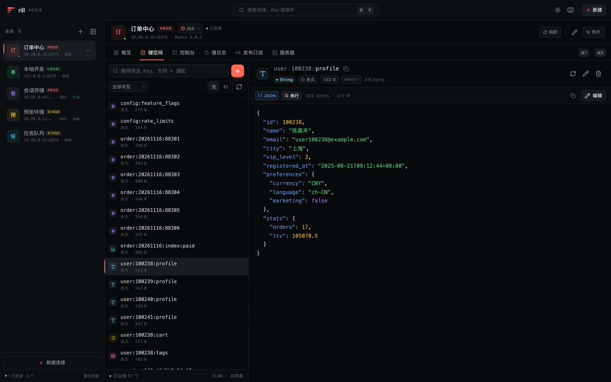 | 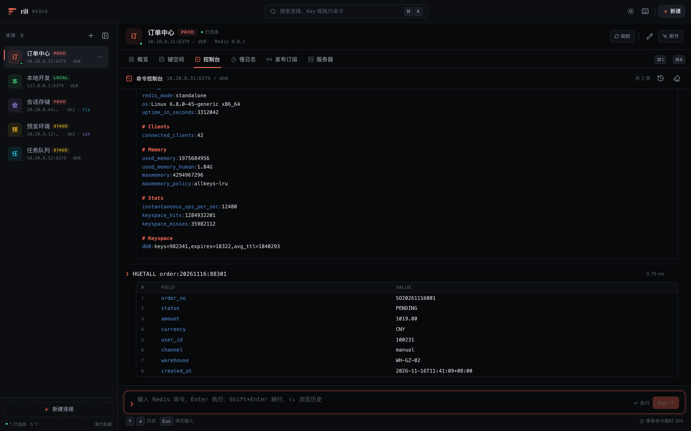 |

| 发布订阅 | 空间分析 |
| --- | --- |
| 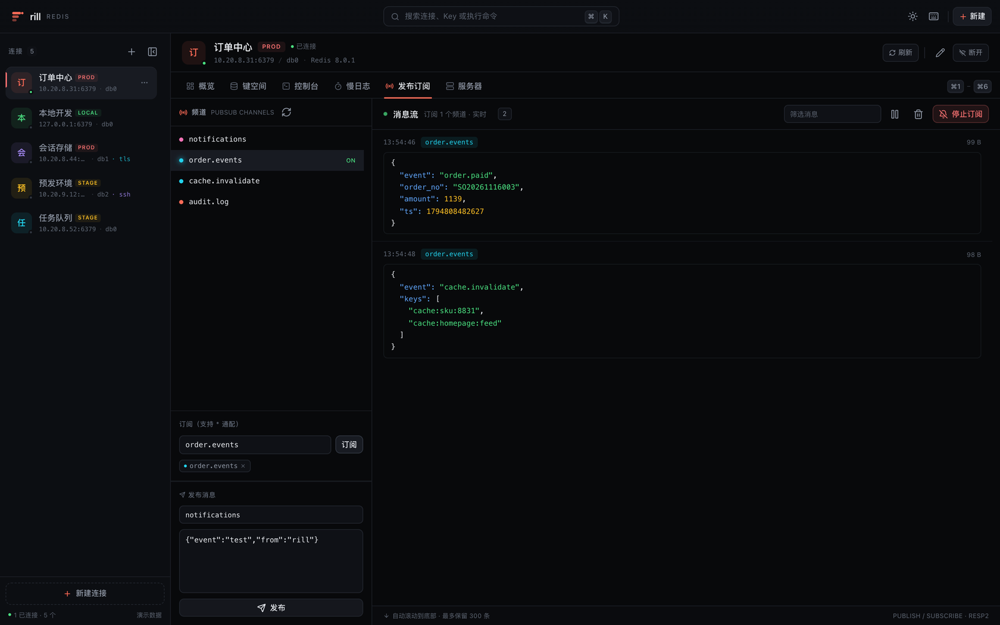 | 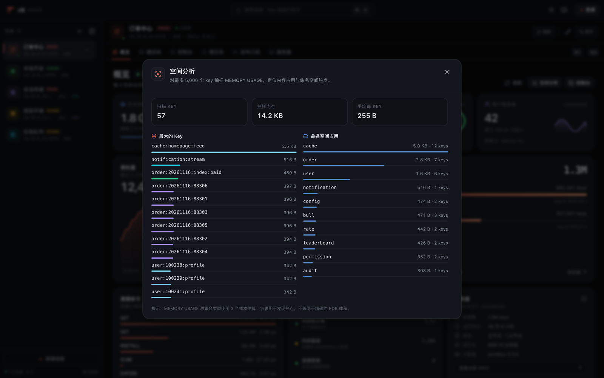 |

| 数据库切换 | Key 模糊筛选 |
| --- | --- |
| 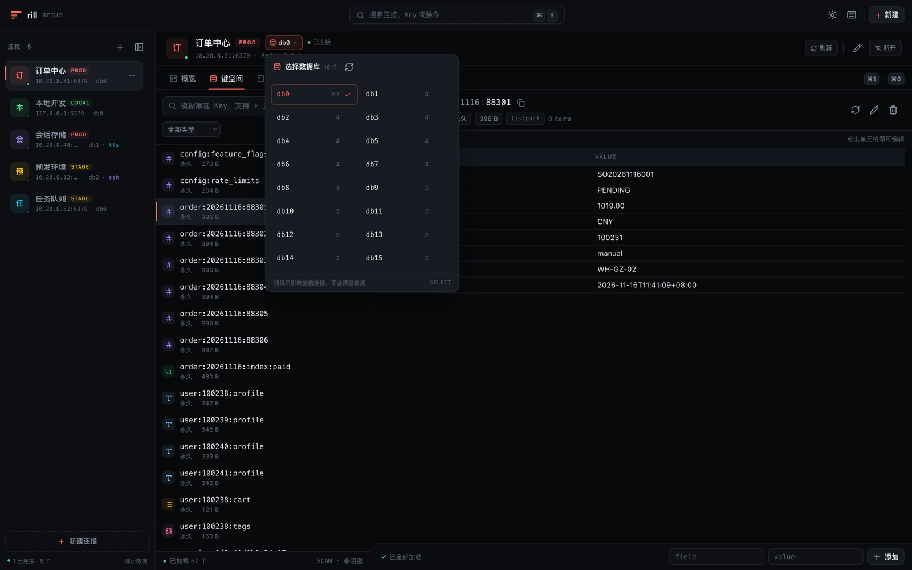 | 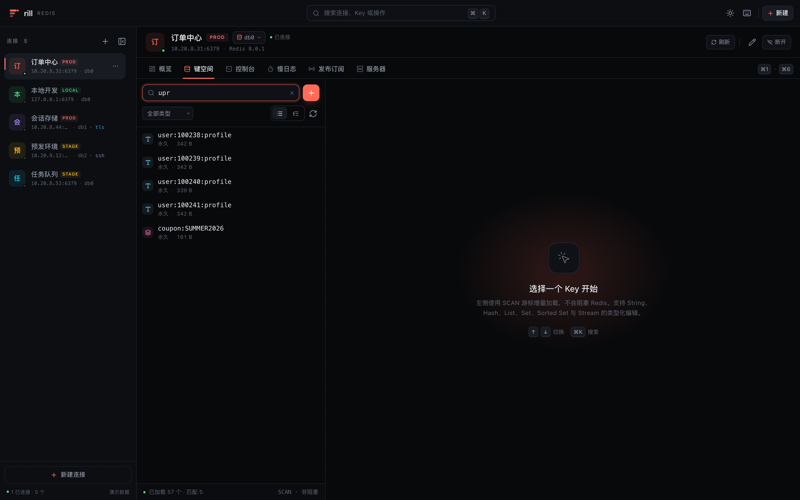 |

| 命名空间树（全量聚合） | 慢日志 |
| --- | --- |
| 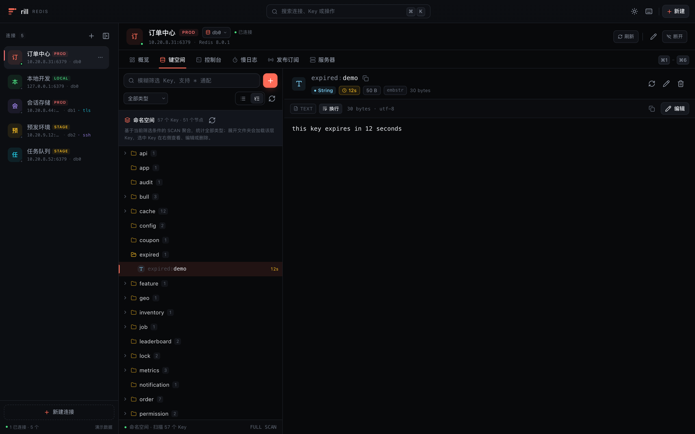 | 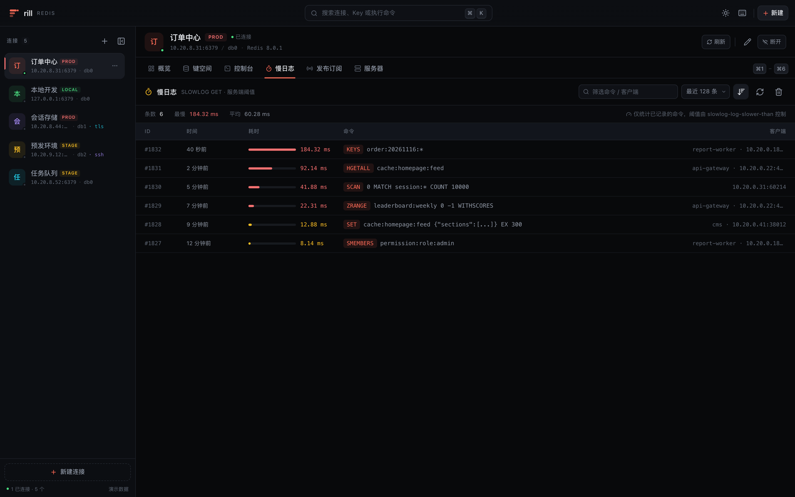 |

| 命令面板 | 浅色主题 |
| --- | --- |
| 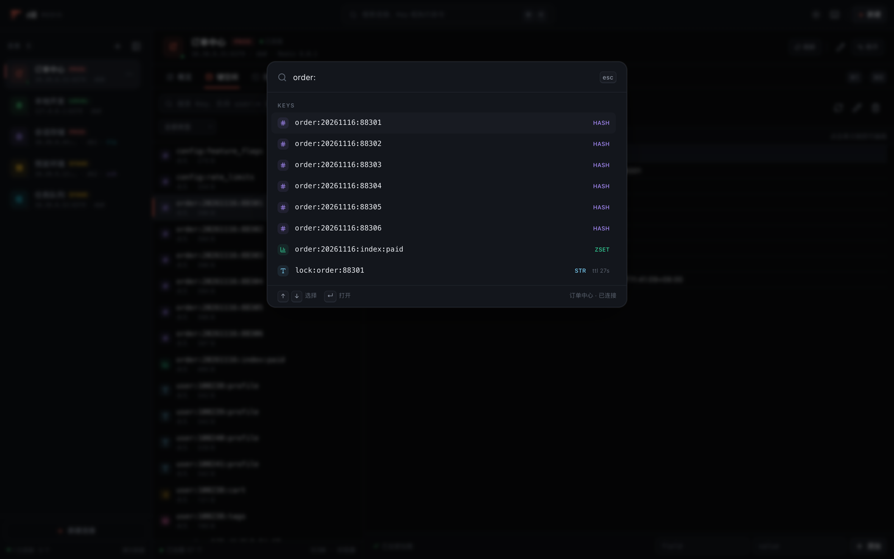 | 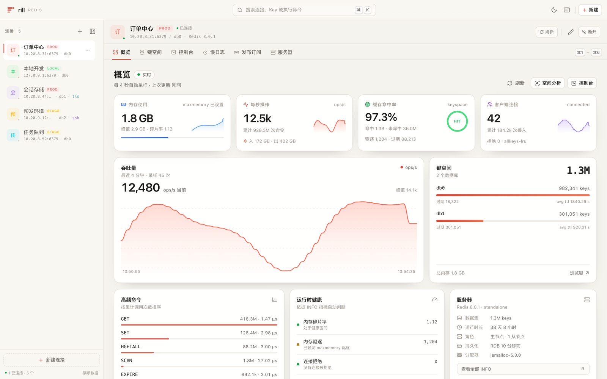 |

<sub>截图使用内置演示数据，便于在没有 Redis 服务时预览界面。</sub>

---

## 性能

实测环境：Apple Silicon、Redis 8.0.1 本机 loopback、**1,000,000 个 Key / 146 MB**。

| 操作 | 实测耗时 |
| --- | --- |
| 连续 5 页 SCAN（1,002 个 Key） | **11.1 ms**（约 2.2 ms/页） |
| 打开一个 String Key（TYPE/TTL/ENCODING/MEMORY/GET） | **1.2 ms** |
| 概览刷新（INFO + DBSIZE + SLOWLOG LEN） | **0.3 ms** |
| 空间分析 1,000 个 Key | **9.2 ms** |
| 数据库列表（INFO keyspace + CONFIG GET databases） | **0.2 ms** |

这些是 loopback 数字，真实网络会叠加 RTT；但它们说明瓶颈不在客户端解析或渲染。

设计上的硬性保护：

- **永不 `KEYS *`**：控制台里的 `KEYS` 也被禁用，只保留 SCAN 路径。
- **SCAN 分页 + 虚拟列表**：每页 200 个 Key，DOM 只渲染视口内的十几行。
- **按需加载**：1,000,000 个 Key 不会进入前端内存；列表只加载滚动/搜索到的页。
- **服务端树聚合**：命名空间树在后端 `SCAN` 全库并只返回前缀计数，不把全部 Key 传给前端；单次最多扫描 50 万 Key / 8 秒，超出会明确提示「部分扫描」。展开某个命名空间时，后端只扫并返回这一层的直属 Key，一次最多 200 个，剩余可按进度继续加载。
- **单项上限**：String 读取 512 KB、集合每页 100 项、空间分析最多 5,000 个 Key。
- **渲染上限**：控制台结果超过 500 项会截断展示；命名空间节点最多返回 8,000 个。
- **异步 + 超时**：所有 Redis I/O 在 Rust 异步运行时里，单条命令 25–30 s 超时，UI 只显示 loading，不会卡住事件循环。
- **阻塞命令隔离**：`MONITOR`、`BLPOP`、`SUBSCRIBE` 等不会复用主连接；控制台会拒绝会卡住连接的命令。

需要说明的边界：Redis 没有二级索引，**模糊筛选不是“全库瞬时索引”**。它先即时过滤已加载的页，同时用 `SCAN ... MATCH` 分批补全；在百万级实例上，要找到一条尚未扫描到的 Key，仍可能要点「继续扫描」或输入更精确的模式。这是 SCAN 的语义决定的，不是客户端卡死。

---

## 快速开始

环境要求：macOS 12+、Node.js 20+、pnpm 10+、Rust 1.80+；目标 Redis 5.0+（已兼容 Redis 5 不支持 SCAN TYPE 的情况）。

```bash
pnpm install
pnpm app:dev      # 开发模式（Vite + Tauri 窗口）
pnpm app:build    # 构建 .app
pnpm package:mac  # 构建 .app + DMG（release/）
```

产物：

```text
src-tauri/target/release/bundle/macos/Rill.app
```

也可以只启动浏览器预览（内置 Mock 数据，不需要 Redis）：

```bash
pnpm dev
# http://localhost:1420/?mock=1
```

真实连接：启动应用 → 新建连接 → 填写主机/端口 → 测试连接 → 创建。

### 打包与分发

运行 `pnpm package:mac` 会在本地生成 `release/Rill-x.y.z-arm64.dmg` 与 `release/Rill.app`，构建产物不提交到 git，可上传到 GitHub Releases。

应用使用本地 ad-hoc 签名。若从网络下载后 Gatekeeper 拦截，可右键「打开」，或：

```bash
xattr -dr com.apple.quarantine /Applications/Rill.app
```

---

## 快捷键

| 快捷键 | 动作 |
| --- | --- |
| `⌘K` | 命令面板 / 搜索 Key |
| `⌘N` | 新建连接 |
| `⌘B` | 收起 / 展开侧栏 |
| `⌘1` … `⌘6` | 概览 / 键空间 / 控制台 / 慢日志 / 发布订阅 / 服务器 |
| `⌘R` | 刷新当前视图 |
| `↑` `↓` | 键列表移动选择 |
| `/` | 聚焦键空间搜索 |
| `⌘S` | 保存 String 编辑 |
| `↵` | 执行控制台命令 / 确认弹窗 |

---

## 架构

```text
┌──────────────────────────────────────────────┐
│  WKWebView (React 19 + TypeScript + Tailwind) │
│  Zustand · TanStack Virtual · 手写 SVG 图表   │
└──────────────────────┬───────────────────────┘
                       │ Tauri IPC (invoke / events)
┌──────────────────────▼───────────────────────┐
│  Rust core                                   │
│  session  连接池 / TLS / SSH 隧道 / PING      │
│  keys     SCAN / 类型化读取 / 写入 / 空间分析  │
│  admin    INFO / SLOWLOG / CLIENT LIST        │
│  console  命令解析 / 危险命令 / RESP2 转换     │
│  pubsub   SUBSCRIBE / PSUBSCRIBE → event      │
│  store    JSON 配置 + macOS Keychain          │
└──────────────────────┬───────────────────────┘
                       │ RESP2
                  Redis Server
```

关键取舍：

- **Rust 负责所有网络与序列化**：前端不做阻塞 I/O，界面不会被慢命令拖住。
- **MultiplexedConnection**：同一连接复用，避免每条命令建连；阻塞类命令走独立连接或被禁用。
- **服务端限流**：String 读取上限 512 KB、集合分页 100、空间分析最多 50,000 个 Key。
- **不缓存键空间**：每次过滤重新 SCAN，避免大库内存膨胀；Tree 只聚合已加载的 Key。
- **双层只读**：UI 不给入口，后端 `ensure_writable` 仍会拒绝，防止绕过。

### 目录

```text
rill/
├── src/                     # React 前端
│   ├── components/          # 壳层、通用 UI、命令面板、连接弹窗
│   ├── views/               # 概览 / 键空间 / 控制台 / 慢日志 / 发布订阅 / 服务器
│   └── lib/                 # API 桥、Mock、Store、格式化
├── src-tauri/
│   ├── src/session.rs       # 连接、TLS、SSH、测试
│   ├── src/keys.rs          # SCAN、值读写、空间分析
│   ├── src/admin.rs         # INFO、慢日志、客户端
│   ├── src/console.rs       # 控制台与 RESP2 → JSON
│   ├── src/pubsub.rs        # 订阅事件
│   ├── src/store.rs         # 配置文件 + Keychain
│   └── src/commands.rs      # Tauri 命令
├── docs/ANALYSIS.md         # 产品与竞品分析
└── docs/screenshots/
```

---

## 安全模型

- 配置文件：`~/Library/Application Support/Rill/connections.json`，目录 700、文件 600
- 密码：`security add-generic-password` 写入 macOS 钥匙串；读取时按连接 ID 取用
- 只读模式：所有写操作在 Rust 层拒绝；控制台按命令白名单判断
- 危险命令：前端二次确认；阻塞/破坏连接的命令在控制台直接禁用
- TLS：rustls + 系统信任根；可选「跳过证书校验」（会明确警告）
- SSH：`BatchMode` + 密钥/agent，不保存私钥；隧道随连接关闭而终止
- 无遥测、无外部请求（只有你配置的 Redis、SSH 主机）

---

## 验证

```bash
# Rust 核心流程（需要本地 Redis 127.0.0.1:6379）
cd src-tauri && cargo test --lib

# 前端类型检查 + 生产构建
pnpm build
```

测试覆盖：连接、PING、String 写入/TTL、Hash 创建/写入、SCAN、INFO、CLIENT LIST、SLOWLOG、空间分析、重命名/删除、DB 选择、只读拦截、Keychain 往返。

本次在 macOS 26.2 (arm64) + Redis 8.0.1 上验证通过：

```text
running 2 tests
test tests::keychain_roundtrip ... ok
test tests::redis_core_flow ... ok
```

---

## 已知限制 / Roadmap

**v0.1 不包含**

- Redis Cluster / Sentinel（当前聚焦单机；集群需要跨节点 SCAN 与 slot 路由）
- SSH 密码认证（仅密钥 / ssh-agent）
- 实时 `MONITOR`（阻塞连接模型，计划用独立原始 RESP 流实现）
- Stream 的可视化写入（暂用控制台 `XADD`）
- RedisJSON / TimeSeries 等模块类型的专用编辑器
- 文件导入导出、自动更新、Intel 构建

**后续方向**

- `v0.2`：Cluster/Sentinel、MONITOR、Key 收藏与标签、导入导出、大 Key 全库扫描
- `v0.3`：保存查询、Key 变更监听、团队共享连接模板、Windows/Linux 构建

---

## License

Apache License 2.0. See [LICENSE](LICENSE).
